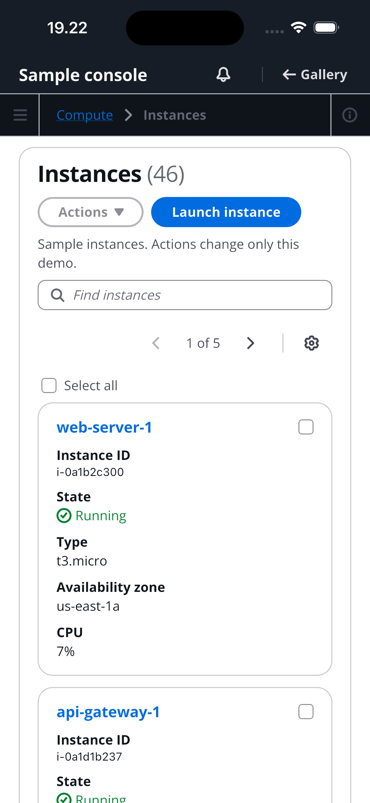
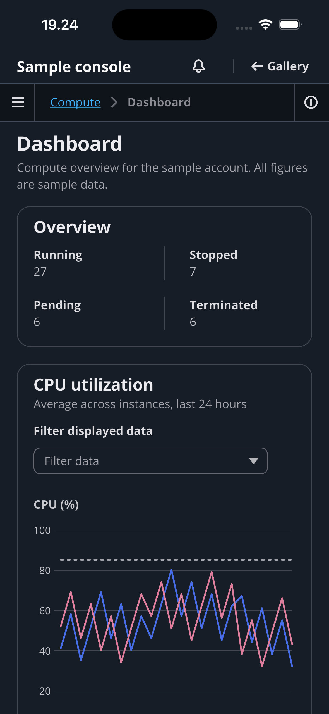
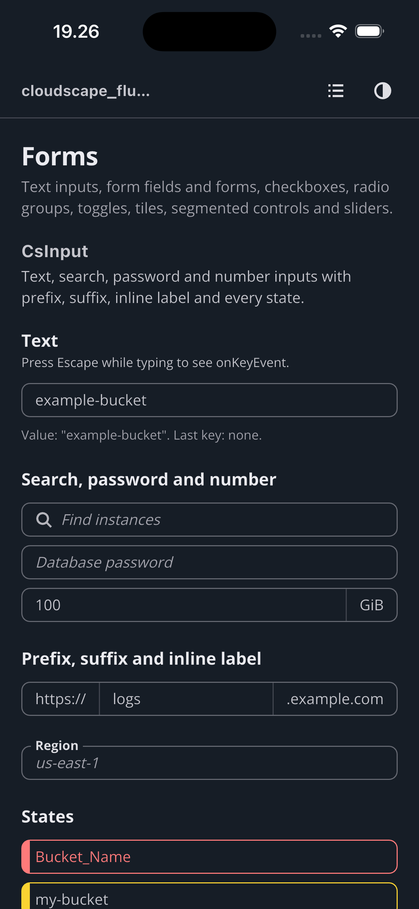

# cloudscape_flutter

[](https://pub.dev/packages/cloudscape_flutter)
[](https://github.com/mralifakbar/cloudscape_flutter/actions/workflows/ci.yml)
[](LICENSE)
[](https://flutter.dev)

An unofficial Flutter port of the [Cloudscape Design System](https://cloudscape.design), the open-source design system AWS builds its consoles with. It brings every token of Cloudscape's visual refresh theme, the 148 Cloudscape icons and more than 100 documented components to Flutter, adapted so the same console language also works on phones.

> **Not affiliated with AWS.** This is an independent, community-maintained port of the open-source Cloudscape Design System (Apache-2.0). "AWS", "Amazon Web Services" and "Cloudscape" are used only to say what this package is a port of. No AWS logos, service icons or the Amazon Ember font are included.

<p>
  
  
  
</p>

## Why

Cloudscape ships for React. This package brings the same tokens, components and behavior to Flutter, so a Flutter app on iOS, Android, web or desktop can look and behave like a Cloudscape console.

- **Every token, generated.** The 1,173 tokens of Cloudscape's visual refresh theme (807 colors in light and dark, comfortable and compact density, borders, type, shadows, motion and the eight visual contexts) are generated from the theme preset inside `@cloudscape-design/components`, about twice what the public tokens package exposes. Prop names follow Cloudscape (`variant`, `value`/`onChange`, `visible`/`onDismiss`, `items`, `selectedItems`), so the Cloudscape docs translate directly.
- **Real Cloudscape icons.** The 148 icons are drawn as vector outlines with Cloudscape's per-size stroke widths, and directional ones mirror in right-to-left layouts.
- **Console-dense, phone-ready.** Controls keep Cloudscape's 32px height (28px compact); on touch screens every hit area grows to 44px. At Cloudscape's 688px mobile breakpoint the app layout's panels become overlays, dropdowns open as bottom sheets, and tables can become cards.
- **Motion that answers touch.** Cloudscape's motion tokens for transitions, springs that start from wherever an element is for anything a finger touches, sheets that follow the finger. Nothing loops forever, and disabled or reduced motion is respected everywhere.
- **Accessible by default.** Semantics, keyboard support (arrow keys in groups, Escape, focus traps), Cloudscape's focus ring, live announcements, 2x text and RTL.
- **Built for AI coding agents.** One reference page per component, `llms.txt`, and two installable agent skills: one for components and tokens, one for the craft standard with a delivery checklist.
- **Small footprint.** Depends only on Flutter and `clock`. Charts are painted with `CustomPainter`.

## Install

```sh
flutter pub add cloudscape_flutter
```

Requires Flutter 3.38 or newer. Open Sans is bundled.

## Quick start

```dart
import 'package:cloudscape_flutter/cloudscape_flutter.dart';
import 'package:flutter/material.dart';

void main() => runApp(const App());

class App extends StatelessWidget {
  const App({super.key});

  @override
  Widget build(BuildContext context) {
    return CsThemeProvider(
      child: Builder(
        builder: (context) => MaterialApp(
          theme: csMaterialTheme(context.cs),
          home: const InstancesPage(),
        ),
      ),
    );
  }
}

class InstancesPage extends StatelessWidget {
  const InstancesPage({super.key});

  @override
  Widget build(BuildContext context) {
    return Scaffold(
      body: SafeArea(
        child: Padding(
          padding: const EdgeInsets.all(CsSpace.l),
          child: CsSpaceBetween(
            size: CsSpacingSize.l,
            children: [
              CsHeader(
                variant: CsHeaderVariant.h1,
                title: 'Instances',
                counter: '(2)',
                actions: CsButton(text: 'Launch instance', variant: CsButtonVariant.primary, onPress: () {}),
              ),
              const CsContainer(
                header: CsHeader(title: 'web-server-1'),
                child: CsStatusIndicator(type: CsStatusType.success, text: 'Running'),
              ),
            ],
          ),
        ),
      ),
    );
  }
}
```

## What is included

| Area | Components |
| --- | --- |
| Foundation | `CsThemeProvider`, `CsVisualContext`, `CsDensityScope`, tokens, `CsBox`, `CsSpaceBetween`, `CsIcon` + `CsIcons`, `CsIconProvider`, `CsButton`, `CsSpinner`, `CsTooltip`, `CsPressable`, `CsNavigableGroup` |
| Layout | `CsAppLayout`, `CsAppLayoutToolbar`, `CsContentLayout`, `CsContainer`, `CsHeader`, `CsColumnLayout`, `CsGrid`, `CsDivider`, `CsExpandableSection`, `CsTabs`, `CsSplitPanel`, `CsDrawer`, `CsPanelLayout`, `CsHelpPanel` |
| Navigation | `CsTopNavigation`, `CsSideNavigation`, `CsBreadcrumbGroup`, `CsAnchorNavigation`, `CsPagination`, `CsLink`, `CsWizard`, `CsSteps`, `CsTreeView` |
| Forms | `CsForm`, `CsFormField`, `CsInput`, `CsTextarea`, `CsControlGroup`, `CsCheckbox`, `CsRadioGroup`, `CsRadioButton`, `CsToggle`, `CsTiles`, `CsSegmentedControl`, `CsSlider` |
| Selection and filtering | `CsSelect`, `CsMultiselect`, `CsAutosuggest`, `CsOptionList`, `CsToken`, `CsTokenGroup`, `CsTextFilter`, `CsPropertyFilter` |
| Actions | `CsButtonDropdown`, `CsButtonGroup`, `CsToggleButton`, `CsCopyToClipboard` |
| Editors and uploads | `CsAttributeEditor`, `CsTagEditor`, `CsFileUpload`, `CsFileInput`, `CsFileDropzone`, `CsFileTokenGroup`, `CsPromptInput`, `CsCodeEditor` |
| Dates and time | `CsCalendar`, `CsDateInput`, `CsDatePicker`, `CsDateRangePicker`, `CsTimeInput` |
| Feedback and overlays | `CsModal`, `CsDialog`, `CsPopover`, `CsFlashbar`, `CsAlert`, `CsProgressBar`, `CsSkeleton`, `CsLiveRegion`, `CsErrorBoundary` |
| Display | `CsBadge`, `CsStatusIndicator`, `CsKeyValuePairs`, `CsList`, `CsTextContent`, `CsTruncatedText` |
| Collections | `CsTable`, `CsCards`, `CsItemCard`, `CsActionCard`, `CsCollectionPreferences`, `CsS3ResourceSelector`, `CsCollection` (the `useCollection` port), composable `CsTableRoot` / `CsTableHead` / `CsTableRow` / `CsTableHeaderCell` / `CsTableBody` / `CsTableBodyCell` |
| Charts | `CsLineChart`, `CsAreaChart`, `CsBarChart`, `CsMixedLineBarChart`, `CsPieChart` |
| Generative AI | `CsChatBubble`, `CsAvatar`, `CsLoadingBar`, `CsSupportPromptGroup`, `CsPromptInput`, `CsCodeView` |
| Dashboards | `CsBoard`, `CsBoardItem`, `CsItemsPalette` |
| Onboarding | `CsAnnotationContext`, `CsHotspot`, `CsTutorialPanel` |

## Documentation

- Guides: [getting started](doc/guides/getting-started.md), [theming](doc/guides/theming.md), [tokens](doc/guides/tokens.md), [motion](doc/guides/motion.md), [mobile](doc/guides/mobile.md), [accessibility](doc/guides/accessibility.md), [for AI agents](doc/guides/for-ai-agents.md).
- One page per component in [doc/components](doc/components). Every code block on those pages is compiled in CI.
- [llms.txt](llms.txt) indexes all of it for language models; [llms-full.txt](llms-full.txt) has it in one file.

## For AI agents

```sh
dart run cloudscape_flutter:install_skill            # installs the skills into .claude/skills
dart run cloudscape_flutter:install_skill --agents   # also adds a pointer to AGENTS.md
```

## Example app

`example/` holds a gallery with a live demo of every component (light, dark and compact, every variant) and a sample cloud console (instances, a dashboard, a launch wizard) built only from cloudscape_flutter. All names and numbers in it are sample data.

```sh
cd example
flutter run
```

## Contributing

Read [CONTRIBUTING.md](CONTRIBUTING.md): it is the contract every component follows (Cloudscape prop names, tokens, the motion contract, mobile rules, accessibility and tests). Report security issues privately as described in [SECURITY.md](SECURITY.md).

## License

Apache 2.0. See [LICENSE](LICENSE) and [NOTICE](NOTICE). Cloudscape Design System is Apache 2.0 licensed by Amazon.com, Inc. or its affiliates; Open Sans is under the SIL Open Font License 1.1.
